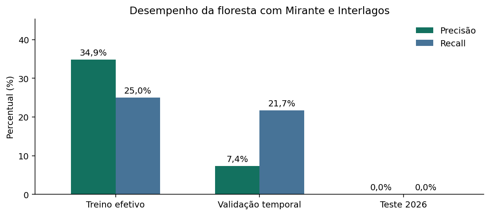

# Rota Seca | Previsão de alagamento em São Paulo

**FIAP · Global Solution CitizenTech 2026 · Engenharia de Software · IA e Machine Learning**

Guilherme Barbiero (RM555185) · Marco Antonio Gonçalves (RM556818) · Vinicius Castro (RM556137) · Camila Mie Takara (RM555418) · Matheus Cantiere (RM558479)

## O que o modelo tenta prever?

O Rota Seca investiga o desafio CitizenTech de prever enchentes e alertar a população. Com os dados disponíveis às 14h, conseguimos antecipar um novo registro de alagamento até as 15h? Cada exemplo corresponde a um cruzamento e uma hora. O alvo vale 1 se o Centro de Gerenciamento de Emergências Climáticas (CGE) registra um início na hora seguinte. Vale 0 nos demais casos, inclusive quando um alagamento anterior continua ativo.

Selecionamos quatro cruzamentos em Itaim Bibi, Campo Grande e Santo Amaro a partir dos boletins do primeiro semestre de 2023. Em 2025, a floresta com chuva do Mirante antecipou 1 de 10 inícios, com 19 avisos. Para testar se uma estação mais próxima ajudaria, incorporamos 2025 ao desenvolvimento e reservamos janeiro a setembro de 2026 para o teste. [Boletins do CGE](https://www.cgesp.org/v3/alagamentos.jsp)

## Dados reais e cobertura

Usamos chuva acumulada em 1, 3 e 24 h no Mirante de Santana e em Interlagos, registros do CGE até a véspera, hora, mês, elevação, declividade e distância ao córrego. Uma alternativa acrescentou os relatos de chuva de Congonhas, com indicação de dado ausente. [INMET](https://portal.inmet.gov.br/dadoshistoricos) · [Congonhas/IEM](https://mesonet.agron.iastate.edu/request/download.phtml?network=BR__ASOS) · [GeoSampa](https://novogeosampa.prefeitura.sp.gov.br/) · [NASA SRTM](https://doi.org/10.5067/MEaSUREs/SRTM/SRTMGL1.003)

| Cruzamentos × horas | Emissões possíveis | Com 24 h nas duas estações | Inícios com cobertura |
|---|---:|---:|---:|
| Desenvolvimento · 2023 a 2025 | 105.212 | 90.640 (86,2%) | 60 de 64 |
| Teste · jan a set/2026 | 26.204 | 23.232 (88,7%) | 9 de 10 |

Todos os modelos foram comparados nas mesmas horas. A exigência de 24 h de chuva válida nas duas estações excluiu um dos dez inícios registrados no teste. [Cobertura e registro excluído](dados/README.md)

## Treino e seleção

A **Random Forest** permite que uma mesma quantidade de chuva tenha efeitos diferentes conforme o terreno e a chuva anterior. Usamos a regressão logística como referência linear e ponderamos as classes nos dois métodos. Com as mesmas duas estações, a precisão média (AP) na validação foi 0,04353 para a floresta e 0,01803 para a logística.

Em cada uma de quatro combinações de fontes, avaliamos a regressão e **12 florestas**. Variamos árvores (32/64), profundidade (3/5/8) e mínimo de exemplos por folha (8/32). Cada ajuste usou todos os positivos e até 20 mil negativos sorteados com semente fixa. A maior AP nos quatro blocos reunidos correspondeu a 32 árvores, profundidade 5 e mínimo de 8 exemplos por folha. [Grade completa](resultados/otimizacao/grade.csv)

A **validação cruzada temporal** usou quatro semestres de 2024–2025. Em cada bloco, treinamos só com observações anteriores cujo alvo já era conhecido. Dividir as horas aleatoriamente permitiria treinar com dados posteriores à previsão avaliada. Fixamos modelo, calibração e limiar antes do teste de 2026.

## Quanto o modelo acertou?

A calibração logística e o limiar de **3,11%** usaram previsões dos quatro blocos, feitas fora do ajuste de cada floresta. Escolhemos o limiar que maximizou F2, priorizando detectar inícios, com até 25 avisos por 10 mil emissões de validação. A avaliação independente usa os dados de 2026.

| Floresta com duas estações | Treino efetivo | Desenvolvimento | Validação temporal | Teste 2026 |
|---|---:|---:|---:|---:|
| Emissões | 20.060 | 90.640 | 63.984 | 23.232 |
| Inícios antecipados / avaliados | 15 / 60 | 15 / 60 | 5 / 23 | **0 / 9** |
| Avisos emitidos | 43 | 148 | 68 | **40** |
| Precisão / recall | 34,9% / 25,0% | 10,1% / 25,0% | 7,4% / 21,7% | 0% / 0% |
| AP / ROC-AUC | 0,24091 / 0,988 | 0,06690 / 0,988 | 0,04353 / 0,969 | 0,01812 / 0,987 |
| Brier / avisos por 10 mil | 0,002865 / 21,4 | 0,000647 / 16,3 | 0,000354 / 10,6 | 0,000398 / 17,2 |

No gráfico, precisão é a proporção de avisos confirmados e recall é a proporção de inícios antecipados. O treino efetivo incluiu os 60 positivos e 20.000 negativos. Com todos os negativos do desenvolvimento, o modelo continuou acertando os mesmos 15 casos, mas a precisão caiu de 34,9% para 10,1%. A precisão e a AP dependem da proporção de ocorrências na amostra. [Métricas do treino](resultados/otimizacao/metricas_treino_efetivo.csv)

**Sobreajuste e limites.** O recall caiu de 25,0% no treino para 21,7% na validação e 0% no teste. A queda é compatível com sobreajuste. A ROC-AUC, que mede a ordenação dos pares positivo–negativo, ficou em 0,988 no treino e 0,987 no teste. Ainda assim, 66 previsões do teste sem novo registro receberam pontuação maior que o caso positivo mais bem colocado. Com nove inícios avaliáveis, um acerto mudaria o recall em 11,1 pontos percentuais. A amostra pequena, a distância dos pluviômetros e a cobertura dos boletins dificultam isolar o efeito do sobreajuste. [Previsões do teste](resultados/otimizacao/previsoes_2026.csv.gz)

**O que isso significa para quem passa por ali?** A chuva local elevou a AP de 0,00749 para 0,01812 frente à floresta original, mas os 40 avisos ficaram sem confirmação e os nove inícios passaram sem aviso. A previsão continua experimental. Quem precisa decidir por onde passar deve consultar os alertas oficiais e a situação atual da via. [Comparação dos quatro modelos](resultados/otimizacao/metricas_2026.csv)
