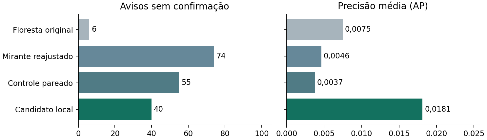

# Rota Seca | Previsão de alagamento em São Paulo

**FIAP · Global Solution CitizenTech 2026 · Engenharia de Software · IA e Machine Learning**

Guilherme Barbiero (RM555185) · Marco Antonio Gonçalves (RM556818) · Vinicius Castro (RM556137) · Camila Mie Takara (RM555418) · Matheus Cantiere (RM558479)

## O que o modelo tenta prever?

Às 14h, com os dados já observados, conseguimos antecipar se o Centro de Gerenciamento de Emergências Climáticas (CGE) registrará o início de um alagamento em um cruzamento até as 15h? Cada exemplo representa um cruzamento em uma hora. O alvo vale 1 para um início no intervalo (14h, 15h] e 0 quando o boletim não registra um início. Um alagamento anterior pode continuar ativo.

O piloto cobre quatro cruzamentos em Itaim Bibi, Campo Grande e Santo Amaro, escolhidos com boletins do primeiro semestre de 2023. Na primeira versão, a floresta usava a chuva do Mirante de Santana e antecipou **1 de 10** inícios em 2025, com 19 avisos. Esse resultado motivou o teste de estações mais próximas. Em seguida, 2025 passou a integrar o desenvolvimento. Reservamos janeiro a setembro de 2026 para a avaliação final. [Boletins do CGE](https://www.cgesp.org/v3/alagamentos.jsp)

## Dados reais e cobertura

O histórico de registros chega até a véspera de cada emissão. A chuva medida na última hora e nos últimos 3 e 24 h vem do Mirante de Santana (A701) e de Interlagos (A771). Também avaliamos os relatos de chuva em Congonhas (SBSP) feitos de 15 a 90 minutos antes da emissão, com um indicador de dados ausentes. Hora, mês, elevação, declividade e distância ao córrego complementam as entradas. O período total vai de janeiro de 2023 a setembro de 2026. [INMET](https://portal.inmet.gov.br/dadoshistoricos) · [Congonhas/IEM](https://mesonet.agron.iastate.edu/request/download.phtml?network=BR__ASOS) · [GeoSampa](https://novogeosampa.prefeitura.sp.gov.br/) · [NASA SRTM](https://doi.org/10.5067/MEaSUREs/SRTM/SRTMGL1.003)

| Cruzamentos × horas | Emissões possíveis | Com 24 h nas duas estações | Inícios com cobertura |
|---|---:|---:|---:|
| Desenvolvimento · 2023 a 2025 | 105.212 | 90.640 (86,2%) | 60 de 64 |
| Teste · jan a set/2026 | 26.204 | 23.232 (88,7%) | 9 de 10 |

Todos os modelos foram avaliados nas mesmas horas. No teste, a janela de chuva incompleta excluiu 2.876 emissões pelo Mirante e outras 96 por Interlagos. Entre estas estava a previsão das 17h de 08/01/2026 na Av. Santo Amaro × Av. Roque Petroni Júnior. O CGE registrou o início às 17h05. [Boletim de 08/01](https://www.cgesp.org/v3/alagamentos.jsp?dataBusca=08%2F01%2F2026)

## Treino e seleção

Escolhemos a **Random Forest** para representar relações não lineares entre chuva, terreno e histórico. Comparamos o Mirante isolado, a estação mais próxima entre as duas, a mais próxima com o máximo regional e essa combinação acrescida de Congonhas. Para cada conjunto, testamos regressão logística e **12 florestas** (32/64 árvores × profundidade 3/5/8 × mínimo de 8/32 exemplos por folha). Cada ajuste usou todos os positivos e uma amostra fixa de até 20 mil negativos, com ponderação das classes.

Validamos nos quatro semestres de 2024 e 2025. Cada modelo aprendeu só com o passado, excluindo a hora cujo horizonte alcançaria o próximo bloco. Ordenamos os candidatos pela precisão média (AP) das previsões reunidas dos quatro blocos. Venceu a floresta com duas estações, 32 árvores, profundidade 5 e mínimo de 8 exemplos por folha. [Grade completa](resultados/otimizacao/grade.csv)

## Quanto o modelo acertou?

A calibração logística e o limiar de **3,11%** usaram previsões dos quatro blocos, feitas fora do ajuste de cada floresta. Escolhemos o limiar que maximizou F2, priorizando detectar inícios, com até 25 avisos por 10 mil emissões de validação. A avaliação independente usa os dados de 2026.

| Floresta com duas estações | Treino efetivo | Desenvolvimento | Validação temporal | Teste 2026 |
|---|---:|---:|---:|---:|
| Emissões | 20.060 | 90.640 | 63.984 | 23.232 |
| Inícios antecipados / avaliados | 15 / 60 | 15 / 60 | 5 / 23 | **0 / 9** |
| Avisos emitidos | 43 | 148 | 68 | **40** |
| Precisão / recall | 34,9% / 25,0% | 10,1% / 25,0% | 7,4% / 21,7% | 0% / 0% |
| AP / ROC-AUC | 0,24091 / 0,988 | 0,06690 / 0,988 | 0,04353 / 0,969 | 0,01812 / 0,987 |
| Brier / avisos por 10 mil | 0,002865 / 21,4 | 0,000647 / 16,3 | 0,000354 / 10,6 | 0,000398 / 17,2 |

O [treino efetivo](resultados/otimizacao/metricas_treino_efetivo.csv) incluiu os 60 positivos e 20.000 negativos. A mesma floresta antecipou os mesmos 15 inícios no desenvolvimento completo, mas os falsos avisos passaram de 28 para 133 ao incluir os demais negativos. A frequência de positivos afeta a precisão, a AP e o Brier. Desenvolvimento completo, validação e teste preservam as proporções observadas em cada período.

| Teste 2026 · mesmas 23.232 emissões | Avisos | Acertos | AP | ROC-AUC | Brier |
|---|---:|---:|---:|---:|---:|
| Floresta original · Mirante | 6 | 0 | 0,00749 | 0,788 | 0,000387 |
| Mirante · reajuste com seleção própria | 74 | 0 | 0,00463 | 0,932 | 0,000388 |
| Mirante · mesmos parâmetros do candidato | 55 | 0 | 0,00374 | 0,932 | 0,000387 |
| Candidato · Mirante e Interlagos | 40 | 0 | 0,01812 | 0,987 | 0,000398 |

Precisão mede a fração dos avisos confirmados e recall a fração dos inícios antecipados. AP resume a relação precisão–recall em vários limiares, ROC-AUC mede a ordenação e Brier mede o erro quadrático das probabilidades. A queda do recall de 25% no treino para 0% no teste é compatível com sobreajuste. Com nove inícios, um acerto mudaria o recall em 11,1 pontos percentuais.

**Decisão para o cidadão.** A chuva local melhorou a ordenação pela AP, mas os 40 avisos ficaram sem confirmação e os nove inícios passaram sem aviso. A primeira floresta emitiu seis avisos, também sem acerto. Mantemos a primeira versão como referência e o candidato para estudo. As evidências são insuficientes para ativar alertas ou indicar travessia segura. Para decidir o trajeto, o cidadão precisa de informação oficial atualizada sobre a via. [Métricas e matriz de confusão](resultados/otimizacao/metricas_2026.csv)
